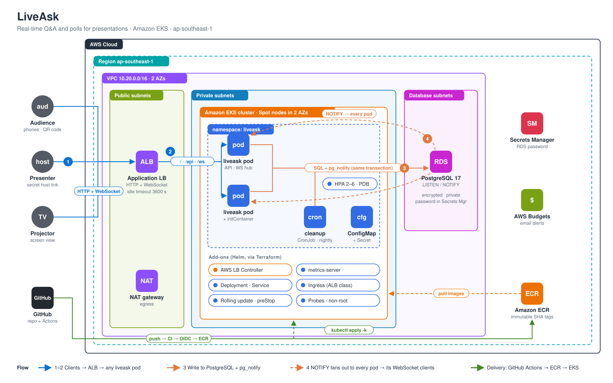
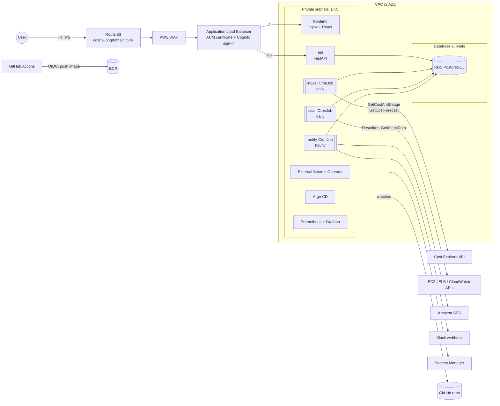

# Architecture (target)

## 1. High level



_Edit [`docs/images/make_architecture.py`](docs/images/make_architecture.py) and run `python docs/images/make_architecture.py` to regenerate the SVG._

<details>
<summary>Same diagram as Mermaid (text version)</summary>



</details>

**Request path:** browser → Route 53 → WAF → ALB (TLS ends here; ALB forces Cognito sign-in) → `frontend` pods for `/`, `api` pods for `/api/*` → PostgreSQL.

**Data path:** `ingest` pulls costs from Cost Explorer once a day → upserts into Postgres. `scan` calls EC2/ELB/CloudWatch describe APIs → upserts findings. `notify` reads new costs/findings → sends deduplicated alerts. The API only reads pre-aggregated tables, so pages are fast and cheap.

## 2. Components

| Component | Kind | Responsibility | AWS access (Pod Identity role) |
|---|---|---|---|
| `frontend` | Deployment | React dashboard served by nginx | none |
| `api` | Deployment + HPA | REST API over Postgres | none (DB only) |
| `ingest` | CronJob `0 2 * * *` UTC | Import daily costs + forecast | `ce:GetCostAndUsage`, `ce:GetCostForecast` |
| `scan` | CronJob `30 2 * * *` UTC | Run waste rules | `ec2:Describe*`, `elasticloadbalancing:Describe*`, `cloudwatch:GetMetricData` (read-only) |
| `notify` | CronJob hourly | Spike/budget/new-waste alerts | `ses:SendEmail` on the verified identity |
| `migrate` | Job (Argo CD PreSync hook) | Alembic migrations before each deploy | none |
| External Secrets Operator | Helm | Syncs DB credentials and Slack webhook from Secrets Manager into K8s Secrets | `secretsmanager:GetSecretValue` on named secrets |
| AWS Load Balancer Controller | Helm | Ingress → ALB | IRSA (exists) |
| Argo CD | Helm | GitOps: syncs `deploy/k8s/overlays/<env>` | none |
| kube-prometheus-stack | Helm | Metrics, Grafana dashboards, alert rules | none |

All four app workloads use **one container image** (`services/cloudcost`) with different commands (`api`, `ingest`, `scan`, `notify`, `migrate`) (D-013).

## 3. Environments

| | staging | prod |
|---|---|---|
| Terraform | `infra/terraform/envs/staging` | `infra/terraform/envs/prod` |
| State key | `cloudcost-watch/staging.tfstate` | `cloudcost-watch/prod.tfstate` |
| Domain | `cost-staging.vuongdomain.click` | `cost.vuongdomain.click` |
| Nodes | 2 × Spot t3.medium | 2–3 × mixed (1 on-demand + Spot) |
| NAT | 1 | 1 (2 noted as the production choice; cost trade-off documented) |
| RDS | single-AZ, 1-day backups | Multi-AZ, 7-day backups, PITR, deletion protection |
| When running | On demand while developing | On demand for demos and screenshots (D-012) |

Same AWS account for both (cost). The README notes that real production would use separate accounts in AWS Organizations.

## 4. Target repository layout

```
services/cloudcost/
  pyproject.toml
  src/cloudcost/
    config.py            settings from env vars (pydantic-settings)
    db/                  SQLAlchemy models, session, alembic/
    aws/                 thin clients: cost_explorer.py, ec2.py, elb.py, cloudwatch.py, ses.py
    pricing.py           static price table per region (MVP)
    rules/               one module per waste rule
    jobs/                ingest.py, scan.py, notify.py
    api/                 FastAPI app, routers/costs.py, findings.py, jobs.py, health.py
    cli.py               entry point: cloudcost api|ingest|scan|notify|migrate
  tests/                 unit tests with fakes and moto
  Dockerfile
frontend/                React + TypeScript + Vite; pages Overview, Costs, Findings, Jobs
infra/terraform/
  modules/platform/      VPC, EKS, add-ons, ECR, RDS (today's code, moved)
  modules/app-iam/       Pod Identity roles for ingest/scan/notify, ESO
  modules/edge/          Route 53 records, ACM, Cognito, WAF
  envs/staging/          main.tf, terraform.tfvars, backend.tf
  envs/prod/
deploy/
  k8s/base/              deployments, cronjobs, services, ingress, hpa, pdb, networkpolicies
  k8s/overlays/local|staging|prod
  argocd/                Application manifests
docs/
  runbooks/              ingest-failed.md, db-restore.md, rollback.md, rotate-secrets.md, teardown.md
  adr/                   (optional) longer write-ups for big decisions
.github/workflows/       ci.yml, build-image.yml (push to ECR), terraform-plan.yml
```

The old `app/` and `k8s/` folders are removed once `services/cloudcost` and `deploy/k8s` replace them (task P1-09).

## 5. Tech stack

| Layer | Choice |
|---|---|
| Language | Python 3.13 (backend, jobs), TypeScript (frontend) |
| API | FastAPI, Pydantic v2, SQLAlchemy 2, Alembic, psycopg 3 |
| AWS SDK | boto3; tests with moto + hand-written fakes for Cost Explorer |
| Frontend | React, Vite, TanStack Query, a chart library (Recharts) |
| Database | RDS PostgreSQL 17 |
| Container platform | Amazon EKS, managed node groups, AL2023 |
| IaC | Terraform (terraform-aws-modules) |
| Delivery | GitHub Actions (CI, image build, Terraform plan) + Argo CD (deploy) |
| Secrets | AWS Secrets Manager + External Secrets Operator |
| Auth | Amazon Cognito via ALB authentication |
| Observability | kube-prometheus-stack (Prometheus, Grafana, Alertmanager), CloudWatch for AWS-side alarms |
| Edge | Route 53, ACM, AWS WAF |
| Email | Amazon SES |
