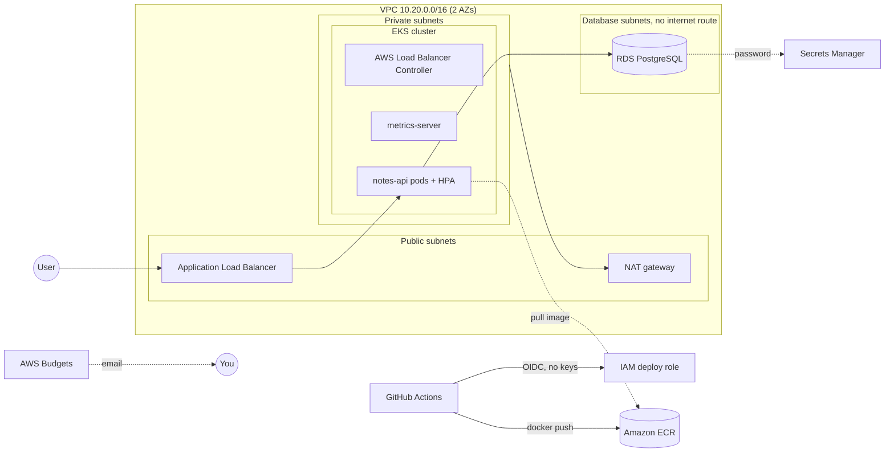

# EKS Platform Lab

A containerized API on **Amazon EKS**, with every AWS resource defined in **Terraform** and deployed by **GitHub Actions over OIDC**. The goal is to learn what a production Kubernetes platform on AWS needs (networking, security, scaling and cost control) while keeping the lab cheap enough to run for a few hours and then destroy.

> Status: scaffolded. Checklist in [Roadmap](#roadmap).

## Architecture



| Layer | What | Why it is built this way |
|---|---|---|
| Network | VPC with public, private and isolated database subnets in 2 AZs | Nodes and database are not reachable from the internet; one NAT gateway saves cost |
| Compute | EKS managed node group, AL2023, Spot `t3.medium` | Spot is ~60-70% cheaper; the PodDisruptionBudget and 2 replicas absorb interruptions |
| Ingress | AWS Load Balancer Controller → ALB, `target-type: ip` | Traffic goes straight to pod IPs; the controller gets IAM rights via IRSA, not the node role |
| Scaling | HorizontalPodAutoscaler on CPU (2-6 pods) | Shown live with `scripts/load-test.sh` |
| Data | RDS PostgreSQL 17, encrypted, private | Password is generated by RDS and kept in Secrets Manager, never in Terraform state or git |
| Registry | ECR, immutable tags, scan on push, keep last 10 | Each deploy is the image of one git commit |
| Access | EKS access entries | The CI role can only edit the `notes` namespace, not the whole cluster |
| CI/CD | GitHub Actions: test → build → push → `kubectl apply -k` | OIDC role trusts only `main` of this repo |
| Cost | Default tags on every resource, AWS Budgets alerts, `terraform destroy` after each session | See [Cost](#cost) |

## Repository layout

```
app/                 FastAPI service (+ tests, Dockerfile)
infra/terraform/     VPC, EKS, add-ons, ECR, RDS, GitHub OIDC role, budget
k8s/base/            Deployment, Service, HPA, PDB
k8s/overlays/aws     + ALB Ingress
k8s/overlays/local   for kind / minikube
scripts/             DB secret, load test
.github/workflows/   ci.yml (every push), deploy.yml (manual)
```

## 1. Run it locally (free)

```bash
docker compose up --build          # API + Postgres -> http://localhost:8000/docs
```

Practice Kubernetes without AWS using [kind](https://kind.sigs.k8s.io/):

```bash
kind create cluster --name notes
docker build -t notes-api:local app
kind load docker-image notes-api:local --name notes
kubectl apply -k k8s/overlays/local
kubectl -n notes port-forward svc/notes-api 8080:80   # http://localhost:8080
```

Or with [minikube](https://minikube.sigs.k8s.io/) (includes metrics-server, so the HPA works locally):

```bash
minikube start -p eks-lab --driver=docker --memory=3072 --cpus=2 --addons=metrics-server
docker build -t notes-api:local app
minikube -p eks-lab image load notes-api:local
kubectl apply -k k8s/overlays/local
./scripts/load-test.sh               # in another terminal: kubectl -n notes get hpa,pods -w
minikube stop -p eks-lab             # when done
```

Tests: `cd app && pip install -r requirements-dev.txt && pytest`

## 2. Deploy to AWS

Requires: Terraform ≥ 1.6, AWS CLI v2 signed in to your account, kubectl, Helm not needed (Terraform installs the charts).

```bash
cd infra/terraform
cp terraform.tfvars.example terraform.tfvars    # fill in owner, github_repo, budget_email
aws eks describe-cluster-versions --region ap-southeast-1 \
  --query "clusterVersions[?versionStatus=='STANDARD_SUPPORT'].clusterVersion"
# make sure kubernetes_version is in that list (extended support costs 6x more)
terraform init
terraform plan -out tfplan
terraform apply tfplan                           # ~15-20 minutes
$(terraform output -raw kubeconfig_command)
cd ../.. && ./scripts/create-db-secret.sh
```

Then in GitHub, set the repository variables `AWS_DEPLOY_ROLE_ARN`, `ECR_REPOSITORY_URL` and `EKS_CLUSTER_NAME` from `terraform output`, and run **Actions → Deploy to EKS**. The last step prints the ALB address.

Watch autoscaling:

```bash
kubectl -n notes get hpa,pods -w      # terminal 1
./scripts/load-test.sh                 # terminal 2
```

## 3. Tear it down

```bash
kubectl delete -k k8s/overlays/aws     # FIRST: lets the controller delete the ALB it created
cd infra/terraform && terraform destroy
```

If you skip the first line, the ALB (created by Kubernetes, not Terraform) can block VPC deletion and keep billing.

## Cost

Approximate on-demand prices in ap-southeast-1. Check the [AWS Pricing Calculator](https://calculator.aws/) before you apply; prices change.

| Resource | ≈ USD / hour |
|---|---|
| EKS control plane (standard support) | 0.10 |
| 2 × t3.medium Spot nodes | ~0.03 |
| NAT gateway (+ data processed) | ~0.06 |
| ALB (+ LCU) | ~0.03 |
| RDS db.t4g.micro + 20 GB gp3 | ~0.03 |
| Public IPv4 addresses (NAT, ALB) | ~0.015 |
| **Total** | **~0.27 / hour ≈ $1 for a 4-hour session** |

Left running for a month it would be around **$190**, so the budget alert and the destroy step are part of the design. Cost decisions made here:

- Spot nodes instead of on-demand.
- One NAT gateway instead of one per AZ.
- Single-AZ RDS on Graviton (`t4g`), no final snapshot.
- ECR lifecycle policy keeps only the 10 newest images; RDS keeps 1 day of backups.
- `Project` tag on everything, to filter Cost Explorer by this lab.

Further ideas: VPC endpoints for ECR/S3 to cut NAT traffic; Karpenter for right-sized nodes; Fargate profile comparison.

## Roadmap

- [x] App with health/readiness probes, tests, non-root image
- [x] Terraform: VPC, EKS, LB controller (IRSA), metrics-server, ECR, RDS, budget
- [x] GitHub Actions: CI and OIDC deploy
- [x] Verified locally: `terraform validate`, app + Postgres in Docker Compose, minikube deploy with HPA scaling 1 → 6 pods under load
- [ ] First `terraform apply` and deploy, screenshot of the app and of the HPA scaling
- [ ] Remote state in S3 (`backend.tf.example`)
- [ ] CloudWatch Container Insights / Prometheus + Grafana dashboard
- [ ] External Secrets Operator instead of `create-db-secret.sh`
- [ ] HTTPS on the ALB with ACM and a Route 53 domain
- [ ] Cost write-up: real bill of one lab session from Cost Explorer

## What I learned

_Fill in as you go: problems you hit, how you debugged them, what you would do differently in production._
